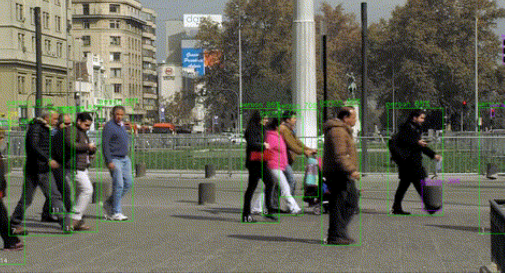
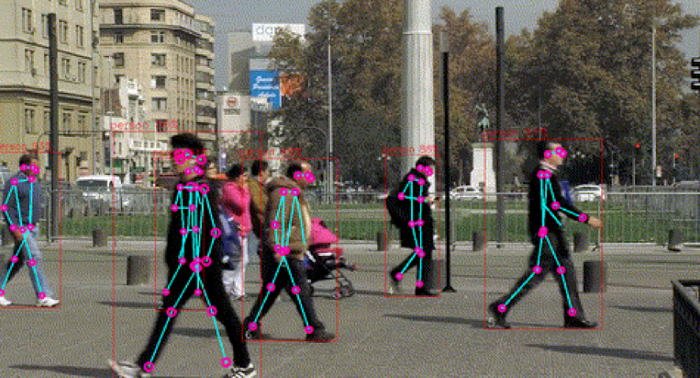
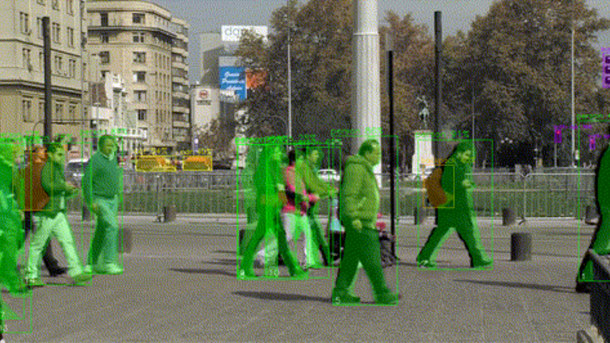
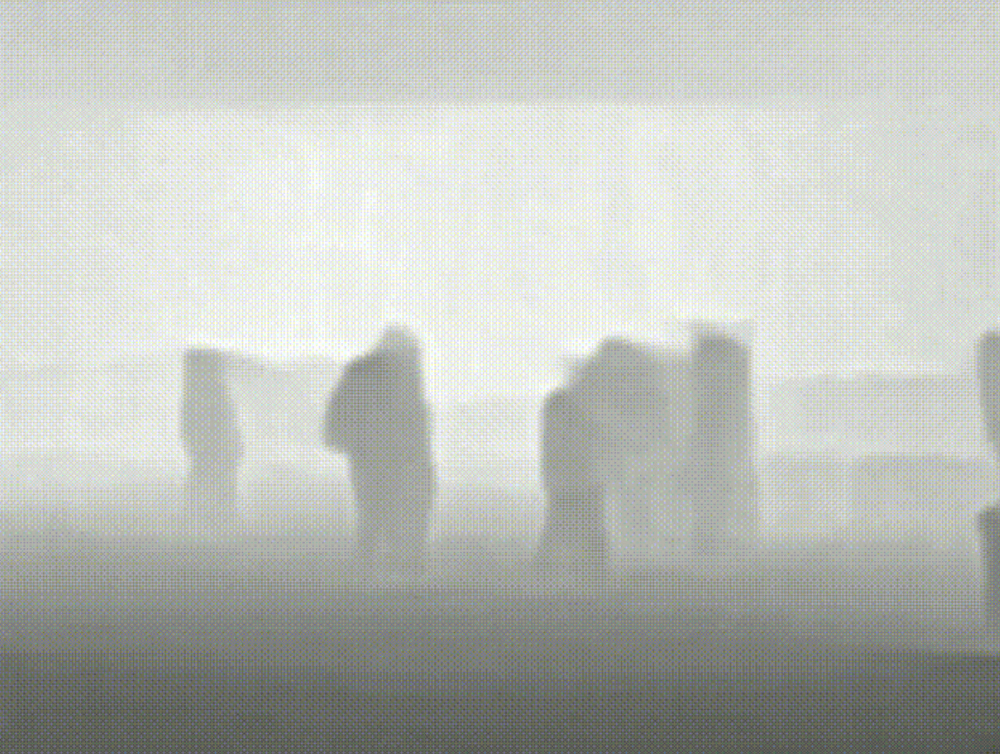

# Computer Vision mit AI Hat

Anleitung:

Ausgangspunkt:
[GitHub](https://github.com/hailo-ai/hailo-rpi5-examples)
Es gibt ein schönes Video dazu:

In diesem GitHub Repo wird auch die offizielle Getting Started Anleitung behandelt:

- [1. Hook up AI Hat+](https://www.raspberrypi.com/documentation/accessories/ai-hat-plus.html): ~ in diesem Dokument: Abschnitt 1
- [2. Install software](https://www.raspberrypi.com/documentation/computers/ai.html): ~ in diesem Dokument: Abschnitt 2
- Erst Abschnitt 3 hat mit diesem Repo zun tun:

## Connect a display

Falls die Befehle von remote (SSH) eingegeben werden und nicht direkt von vom Desktop des Raspberries aus (mit angeschlossener Maus und Tastatur), wird nicht unmittelbar ein Display gefunden, auf dem die Ausgabe der Kamera angezeigt werden soll. In diesem Fall ist ein Zwischenschritt notwendig:
Mit

```
echo $DISPLAY
```

wird herausgefunden, wie das angeschlossene Display heisst.
Beispiel: `:0`
Nun wird per SSH folgender Befehl ausgeführt:

```
export DISPLAY=:0
```

Und dann kann endlich folgender Command ausgeführt werden:

```
rpicam-hello -t 10s
```

Test:

```
rpicam-hello -t 0 --post-process-file /usr/share/rpi-camera-assets/hailo_yolov6_inference.json
rpicam-hello -t 0 --post-process-file /usr/share/rpi-camera-assets/hailo_yolov8_inference.json
rpicam-hello -t 0 --post-process-file /usr/share/rpi-camera-assets/hailo_yolox_inference.json
rpicam-hello -t 0 --post-process-file /usr/share/rpi-camera-assets/hailo_yolov5_personface.json
rpicam-hello -t 0 --post-process-file /usr/share/rpi-camera-assets/hailo_yolov5_segmentation.json --framerate 20
rpicam-hello -t 0 --post-process-file /usr/share/rpi-camera-assets/hailo_yolov8_pose.json
```

Verify Installation

```
hailortcli fw-control identify
gst-inspect-1.0 hailotools
gst-inspect-1.0 hailo
```

## Abschnitt 3: DIY

Folgende Beispiele decken sich mit den Beispielen, die wir oben als Test getestet haben. Diese in diesem Repo präsentieren Lösungswege / Workflows (“Pipelines”) dienen als Startpunkt, eigene AI Applikationen zu bauen. Hier kann ich in Python die Informationen aus den Videos weiterverwenden, die Videoquelle (Kamera, Video, …) selbst festlegen usw.

```
git clone https://github.com/hailo-ai/hailo-rpi5-examples.git
cd hailo-rpi5-examples
./install.sh
source setup_env.sh
```

Dann eines folgender Beispiele testen:

### 1. Detection:

```
python basic_pipelines/detection_simple.py
```



### 2. Pose Estimation:

```
python basic_pipelines/pose_estimation.py
```



### 3. Instance Segmentation:

```
python basic_pipelines/instance_segmentation.py
```



### 4. Depth estimation:

```
python basic_pipelines/depth.py
```



Wenn Raspberry frisch gestartet wird, lassen sich die Commands auch kombinieren, vorausgesetzt, es sind nun alle Packages installiert.

```
cd ~/hailo-rpi5-examples && source setup_env.sh && export DISPLAY=:0 && python basic_pipelines/pose_estimation.py --input rpi
```
