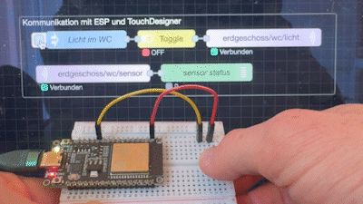
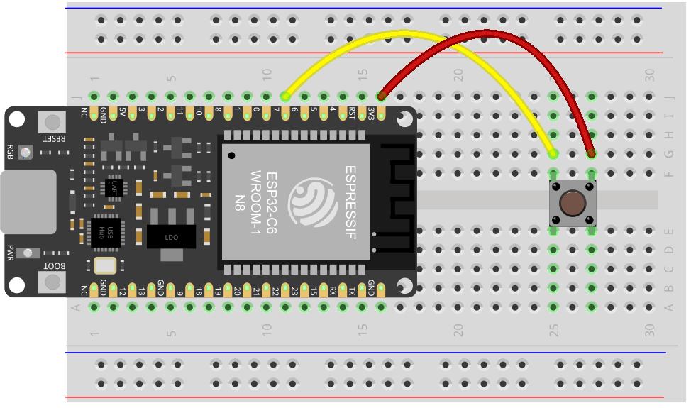

# MQTT Send & Receive mit ESP32

Kurzanleitung zur Inbetriebnahme des ESP32 mit MQTT-Kommunikation am Beispiel Node-Red.
Andere Kommunikationspartner sind ebenfalls möglich.



## 1. Node-Red

Importiere diesen Flow in Node-Red

<details>
<summary><b>Node-RED Flow anzeigen (JSON)</b></summary>

```json
[
  {
    "id": "f8db239ea2210a9b",
    "type": "group",
    "z": "1c1ccda937ce7294",
    "name": "Kommunikation mit ESP und TouchDesigner",
    "style": { "label": true },
    "nodes": [
      "9706f9fce318f43f",
      "bed761109a90c47a",
      "a3b49ee52f817a53",
      "dd91693eacb3a754",
      "2f53e4edd910e895"
    ],
    "x": 974,
    "y": 859,
    "w": 552,
    "h": 142
  },
  {
    "id": "9706f9fce318f43f",
    "type": "mqtt out",
    "z": "1c1ccda937ce7294",
    "g": "f8db239ea2210a9b",
    "name": "",
    "topic": "erdgeschoss/wc/licht",
    "qos": "0",
    "retain": "",
    "respTopic": "",
    "contentType": "",
    "userProps": "",
    "correl": "",
    "expiry": "",
    "broker": "40d0272a08d772d1",
    "x": 1400,
    "y": 900,
    "wires": []
  },
  {
    "id": "bed761109a90c47a",
    "type": "inject",
    "z": "1c1ccda937ce7294",
    "g": "f8db239ea2210a9b",
    "name": "Licht im WC",
    "props": [{ "p": "payload" }, { "p": "topic", "vt": "str" }],
    "repeat": "",
    "crontab": "",
    "once": false,
    "onceDelay": 0.1,
    "topic": "-",
    "payload": "-",
    "payloadType": "str",
    "x": 1090,
    "y": 900,
    "wires": [["a3b49ee52f817a53"]]
  },
  {
    "id": "a3b49ee52f817a53",
    "type": "toggle",
    "z": "1c1ccda937ce7294",
    "g": "f8db239ea2210a9b",
    "name": "",
    "onOffTopic": "",
    "onValue": "1",
    "onType": "num",
    "offValue": "0",
    "offType": "num",
    "toggleTopic": "",
    "toggleValue": "",
    "toggleType": "any",
    "passOnOff": "ifChanged",
    "x": 1230,
    "y": 900,
    "wires": [["9706f9fce318f43f"]]
  },
  {
    "id": "dd91693eacb3a754",
    "type": "mqtt in",
    "z": "1c1ccda937ce7294",
    "g": "f8db239ea2210a9b",
    "name": "",
    "topic": "erdgeschoss/wc/sensor",
    "qos": "1",
    "datatype": "auto-detect",
    "broker": "40d0272a08d772d1",
    "nl": false,
    "rap": true,
    "rh": 0,
    "inputs": 0,
    "x": 1100,
    "y": 960,
    "wires": [["2f53e4edd910e895"]]
  },
  {
    "id": "2f53e4edd910e895",
    "type": "debug",
    "z": "1c1ccda937ce7294",
    "g": "f8db239ea2210a9b",
    "name": "sensor status",
    "active": true,
    "tosidebar": false,
    "console": false,
    "tostatus": true,
    "complete": "payload",
    "targetType": "msg",
    "statusVal": "payload",
    "statusType": "auto",
    "x": 1300,
    "y": 960,
    "wires": []
  },
  {
    "id": "40d0272a08d772d1",
    "type": "mqtt-broker",
    "name": "",
    "broker": "mosquitto",
    "port": 1883,
    "clientid": "",
    "autoConnect": true,
    "usetls": false,
    "protocolVersion": 4,
    "keepalive": 60,
    "cleansession": true,
    "autoUnsubscribe": true,
    "birthTopic": "",
    "birthQos": "0",
    "birthRetain": "false",
    "birthPayload": "",
    "birthMsg": {},
    "closeTopic": "",
    "closeQos": "0",
    "closeRetain": "false",
    "closePayload": "",
    "closeMsg": {},
    "willTopic": "",
    "willQos": "0",
    "willRetain": "false",
    "willPayload": "",
    "willMsg": {},
    "userProps": "",
    "sessionExpiry": ""
  },
  {
    "id": "a285cd03d3595660",
    "type": "global-config",
    "env": [],
    "modules": { "node-red-contrib-toggle": "0.1.1" }
  }
]
```

</details><br>

---

## 2. ESP

### 2.1. Hardware & Steckplan



### 2.2. Software installieren

- **Arduino IDE** installiert
- **ESP32 Board-Paket:** In der Arduino IDE über den Board-Verwalter (_esp32 by Espressif Systems_) installiert.
- **MQTT-Bibliothek:** Über den Bibliotheksverwalter nach **`MQTT`** von _Joel Gaehwiler_ (256dpi) suchen und installieren.

### 2.3. Konfiguration im Code

Öffne den [Arduino-Code](MQTT_ESP_Node-Red.ino), z.B. in der Arduino IDE, bzw. auch hier:

<details>
<summary><b>Arduino-Code anzeigen</b></summary>

```arduino
/******************************************************************************************
 * Button Signal zu TouchDesigner und zurück via MQTT (inkl. GRB-LED Status)
 *
 * LED Status-Indikatoren (GRB-Reihenfolge: Grün, Rot, Blau):
 * - Rot  (0, 255, 0):   Kein WLAN / Verbindungsaufbau
 * - Grün (255, 0, 0):   WLAN verbunden (sucht MQTT)
 * - Gelb (255, 255, 0): WLAN + MQTT verbunden
 * - Blau (0, 0, 255):   MQTT-Nachricht auf "erdgeschoss/wc/licht" mit Payload 1
 *empfangen
 * - Weiß (255, 255, 255): Hardware-Button an Pin 2 wird gedrückt
 ******************************************************************************************/

#include <MQTT.h>
#include <WiFi.h>

///////////////////////////////////////////////// WiFi & MQTT Konfiguration

const char *ssid = "tinkergarden";     // your WLAN ssid
const char *pass = "strenggeheim"; // your WLAN PW
bool isWlanConnected = 0;


const char *broker = "q7"; // falls kein mDNS verfügbar: nimm IP Addresse. Finde heraus am Raspberry pi via "ip addr" "192.168.0.51";
const int mqtt_port = 1883;

const char *subscribe_topics[] = {"erdgeschoss/wc/licht"};
String publish_topic = "erdgeschoss/wc/sensor";

WiFiClient wificlient;
MQTTClient mqttclient;

///////////////////////////////////////////////// Hardware-Pins

int led = LED_BUILTIN;
const int buttonPin = 7; // Pin für den Button

int buttonState = 0;
int prev_buttonState = 0;

// Funktionsprototypen
void connectWiFi();
bool is_wlan_connected();
void connectMQTT();
void messageReceived(String &topic, String &payload);
void sendMQTT();

void setup() {
  Serial.begin(115200);
  delay(1000);

  pinMode(led, OUTPUT);
  pinMode(buttonPin, INPUT_PULLDOWN);

  rgbLedWrite(led, 0, 10, 0); // GRB: rot
  Serial.println("Starte Verbindung...");

  connectWiFi();

  if (WiFi.status() == WL_CONNECTED) {
    connectMQTT();
  }
}

void loop() {
  if (!is_wlan_connected())
    return;

  // Wenn WLAN steht, aber MQTT getrennt ist -> neu verbinden
  if (!mqttclient.connected()) {
    rgbLedWrite(led, 10, 0, 0); // GRB: grün (nur WLAN da, MQTT fehlt)
    connectMQTT();
  }

  mqttclient.loop();
  delay(10); // Stabilität
  sendMQTT();
}

///////////////////////////////////////////////// WLAN Funktionen (Dein
/// Boilerplate)

void connectWiFi() {
  Serial.printf("\nVerbinde mit WLAN %s", ssid);
  WiFi.begin(ssid, pass);

  int attempts = 0;
  while (WiFi.status() != WL_CONNECTED &&
         attempts < 40) { // Max 40 Versuche (20 Sekunden)
    delay(500);
    Serial.print(".");
    attempts++;
  }
  if (WiFi.status() == WL_CONNECTED) {
    Serial.printf("\nWiFi verbunden: SSID: %s, IP-Adresse: %s\n", ssid,
                  WiFi.localIP().toString().c_str());
    rgbLedWrite(led, 10, 0, 0); // GRB: grün
    isWlanConnected = 1;
  } else {
    Serial.println("\n❌ WiFi Verbindung fehlgeschlagen!");
    rgbLedWrite(led, 0, 10, 0); // GRB: rot
  }
}

bool is_wlan_connected() {
  if (WiFi.status() != WL_CONNECTED) {
    if (isWlanConnected == 1) { // War vorher verbunden?
      Serial.println("WiFi-Verbindung verloren, reconnect...");
      rgbLedWrite(led, 0, 10, 0); // GRB: Rot
      isWlanConnected = 0;
    }
    connectWiFi();
    return false; // Loop wird abgebrochen
  }
  return true; // WiFi ist da, Loop darf weiterlaufen
}

///////////////////////////////////////////////// MQTT Funktionen

void connectMQTT() {
  mqttclient.begin(broker, mqtt_port, wificlient);
  mqttclient.onMessage(messageReceived);

  Serial.print("Verbinde mit MQTT-Broker...");

  int attempts = 0;
  // Eigene Client-ID "esp32-c6-wc".
  // Der Mosquitto-Broker auf dem Raspberry Pi erwartet anonymous-Verbindungen
  // (ohne Benutzername/Passwort). Die Zugangsdaten "public", "public" führten
  // dazu, dass der Broker die Verbindung mit "Not authorised" (Code 5)
  // abgelehnt hat.
  while (!mqttclient.connect("esp32-c6-wc") && attempts < 5) {
    Serial.print(".");
    delay(1000);
    attempts++;
    if (WiFi.status() != WL_CONNECTED)
      return; // Abbruch falls WLAN wegfällt
  }

  if (mqttclient.connected()) {
    Serial.println("\nVerbunden mit MQTT-Broker!");

    int numTopics = sizeof(subscribe_topics) / sizeof(subscribe_topics[0]);
    for (int i = 0; i < numTopics; i++) {
      mqttclient.subscribe(subscribe_topics[i]);
    }

    rgbLedWrite(led, 10, 10,
                0); // GRB: gelb (Grün + Rot = Gelb -> WLAN & MQTT verbunden)
  } else {
    Serial.printf("\n❌ Fehler beim Verbinden mit MQTT-Broker! (Error: %d, "
                  "ReturnCode: %d)\n",
                  mqttclient.lastError(), mqttclient.returnCode());
  }
}

///////////////////////////////////////////////// steuere LED bei entsprechender
/// MQTT Nachricht

void messageReceived(String &topic, String &payload) {
  Serial.println("Incoming: " + topic + " - " + payload);
  if (topic == "erdgeschoss/wc/licht") {
    if (payload.toInt() == 1) {
      rgbLedWrite(led, 255, 255, 255); // GRB: blau
    } else {
      rgbLedWrite(led, 10, 10,
                  0); // GRB: zurück auf gelb (MQTT-Verbindungsstatus)
    }
  }
}

///////////////////////////////////////////////// sende MQTT Nachricht bei
/// Knopfdruck

void sendMQTT() {
  buttonState = digitalRead(buttonPin);
  if (buttonState == prev_buttonState)
    return;
  prev_buttonState = buttonState;

  // Feedback auf LED beim Drücken (kurz Weiß, beim Loslassen wieder Gelb)
  if (buttonState == 1) {
    rgbLedWrite(led, 50, 50, 50); // GRB: weiß beim Drücken
  } else {
    rgbLedWrite(led, 10, 10, 0); // GRB: zurück auf gelb
  }

  // Wert via MQTT senden
  Serial.println("Publishing: " + publish_topic + " - " + String(buttonState));
  mqttclient.publish(publish_topic, String(buttonState));
}
```

</details><br>

Vor dem Hochladen folgende Einstellungen:

- **WLAN-Zugangsdaten:**
  - `ssid`: Name deines WLANs (Hinweis: ESP32 unterstützt nur **2.4 GHz** WLANs, kein 5 GHz).
  - `pass`: WLAN-Passwort.
- **MQTT-Broker:**
  - **Lokales Netzwerk (Heimnetz):** Hostname z.B. `q7` .
  - **Schul-, Uni- oder öffentliche Netzwerke (z. B. eduroam):**
    - In restriktiven Netzwerken ist die Hostnamen-Auflösung (mDNS/NetBIOS) meist blockiert.
    - Hier **zwingend die IP-Adresse** des Raspberry Pi eintragen (z. B. `const char *broker = "192.168.0.51";`).
    - **IP-Adresse auf dem Raspberry Pi ermitteln:** Im Terminal des Pi den Befehl `ip addr` ausführen.
  - **Online-Broker (Alternative):** Es können auch öffentliche Broker wie `broker.hivemq.com` oder `test.mosquitto.org` verwendet werden.
  - `mqtt_port`: Standardmässig `1883`.
- **Topics:**
  - `publish_topic`: Topic, an das der Tasterstatus gesendet wird (z. B. `"erdgeschoss/wc/sensor"`).
  - `subscribe_topics`: Topics, die empfangen werden sollen (z. B. `"erdgeschoss/wc/licht"`).

---

## 2.4. ESP32 flashen

- ESP32 per USB mit dem Computer verbinden.
- In der Arduino IDE das passende Board auswählen (z. B. **ESP32-C6 Dev Module** oder passendes ESP32-Board).
- Den zugehörigen seriellen **Port** auswählen.
- Seriellen Monitor öffnen und auf **115200 Baud** einstellen.
- Auf **Upload** (Hochladen) klicken.

---

## 2.5. LED-Statusanzeigen (GRB)

| Farbe        | Zustand              | Bedeutung                                                          |
| :----------- | :------------------- | :----------------------------------------------------------------- |
| 🔴 **Rot**   | Dauerhaft / Blinkend | Kein WLAN / Verbindungsaufbau zum WLAN läuft                       |
| 🟢 **Grün**  | Dauerhaft            | WLAN verbunden, sucht noch MQTT-Broker                             |
| 🟡 **Gelb**  | Dauerhaft            | **Betriebsbereit:** WLAN und MQTT erfolgreich verbunden            |
| ⚪ **Weiss** | Kurz beim Drücken    | Hardware-Taster gedrückt (Signal wird via MQTT publiziert)         |
| 🔵 **Blau**  | Dauerhaft            | Signal auf Topic `"erdgeschoss/wc/licht"` empfangen (`Payload: 1`) |

---

## 2.6. Fehlerbehebung

- **LED bleibt Rot:**
  - SSID und Passwort prüfen.
  - Sicherstellen, dass das WLAN auf 2.4 GHz sendet.
- **LED bleibt Grün:**
  - ESP32 erreicht den MQTT-Broker nicht.
  - Statt des Hostnamens die **IP-Adresse** des Raspberry Pi eintragen.
  - Prüfen, ob der Mosquitto-Broker auf dem Pi läuft (`sudo docker ps`).
