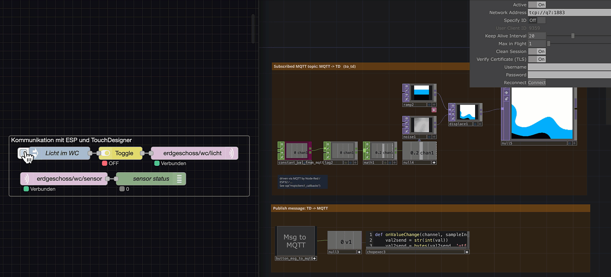

# MQTT Send & Receive mit ESP32

Kurzanleitung zur Inbetriebnahme des ESP32 mit MQTT-Kommunikation am Beispiel Node-Red.
Andere Kommunikationspartner sind ebenfalls möglich.



## 1. Node-Red

Importiere diesen Flow in Node-Red

<details>
<summary><b>Node-RED Flow anzeigen (JSON)</b></summary>

```json
[
  {
    "id": "f8db239ea2210a9b",
    "type": "group",
    "z": "1c1ccda937ce7294",
    "name": "Kommunikation mit ESP und TouchDesigner",
    "style": { "label": true },
    "nodes": [
      "9706f9fce318f43f",
      "bed761109a90c47a",
      "a3b49ee52f817a53",
      "dd91693eacb3a754",
      "2f53e4edd910e895"
    ],
    "x": 974,
    "y": 859,
    "w": 552,
    "h": 142
  },
  {
    "id": "9706f9fce318f43f",
    "type": "mqtt out",
    "z": "1c1ccda937ce7294",
    "g": "f8db239ea2210a9b",
    "name": "",
    "topic": "erdgeschoss/wc/licht",
    "qos": "0",
    "retain": "",
    "respTopic": "",
    "contentType": "",
    "userProps": "",
    "correl": "",
    "expiry": "",
    "broker": "40d0272a08d772d1",
    "x": 1400,
    "y": 900,
    "wires": []
  },
  {
    "id": "bed761109a90c47a",
    "type": "inject",
    "z": "1c1ccda937ce7294",
    "g": "f8db239ea2210a9b",
    "name": "Licht im WC",
    "props": [{ "p": "payload" }, { "p": "topic", "vt": "str" }],
    "repeat": "",
    "crontab": "",
    "once": false,
    "onceDelay": 0.1,
    "topic": "-",
    "payload": "-",
    "payloadType": "str",
    "x": 1090,
    "y": 900,
    "wires": [["a3b49ee52f817a53"]]
  },
  {
    "id": "a3b49ee52f817a53",
    "type": "toggle",
    "z": "1c1ccda937ce7294",
    "g": "f8db239ea2210a9b",
    "name": "",
    "onOffTopic": "",
    "onValue": "1",
    "onType": "num",
    "offValue": "0",
    "offType": "num",
    "toggleTopic": "",
    "toggleValue": "",
    "toggleType": "any",
    "passOnOff": "ifChanged",
    "x": 1230,
    "y": 900,
    "wires": [["9706f9fce318f43f"]]
  },
  {
    "id": "dd91693eacb3a754",
    "type": "mqtt in",
    "z": "1c1ccda937ce7294",
    "g": "f8db239ea2210a9b",
    "name": "",
    "topic": "erdgeschoss/wc/sensor",
    "qos": "1",
    "datatype": "auto-detect",
    "broker": "40d0272a08d772d1",
    "nl": false,
    "rap": true,
    "rh": 0,
    "inputs": 0,
    "x": 1100,
    "y": 960,
    "wires": [["2f53e4edd910e895"]]
  },
  {
    "id": "2f53e4edd910e895",
    "type": "debug",
    "z": "1c1ccda937ce7294",
    "g": "f8db239ea2210a9b",
    "name": "sensor status",
    "active": true,
    "tosidebar": false,
    "console": false,
    "tostatus": true,
    "complete": "payload",
    "targetType": "msg",
    "statusVal": "payload",
    "statusType": "auto",
    "x": 1300,
    "y": 960,
    "wires": []
  },
  {
    "id": "40d0272a08d772d1",
    "type": "mqtt-broker",
    "name": "",
    "broker": "mosquitto",
    "port": 1883,
    "clientid": "",
    "autoConnect": true,
    "usetls": false,
    "protocolVersion": 4,
    "keepalive": 60,
    "cleansession": true,
    "autoUnsubscribe": true,
    "birthTopic": "",
    "birthQos": "0",
    "birthRetain": "false",
    "birthPayload": "",
    "birthMsg": {},
    "closeTopic": "",
    "closeQos": "0",
    "closeRetain": "false",
    "closePayload": "",
    "closeMsg": {},
    "willTopic": "",
    "willQos": "0",
    "willRetain": "false",
    "willPayload": "",
    "willMsg": {},
    "userProps": "",
    "sessionExpiry": ""
  },
  {
    "id": "a285cd03d3595660",
    "type": "global-config",
    "env": [],
    "modules": { "node-red-contrib-toggle": "0.1.1" }
  }
]
```

</details><br>

---

## 2. TouchDesigner

- Öffne das [TouchDesigner-Programm](MQTT_send_receive.toe).
- Achte darauf dass alle Kommunikationsteilnehmer im selben WLAN Netzwerk sind.

- **MQTT-Broker:** Adresse des MQTT Brokers in der Node `MQTT DAT`angeben: `tcp://[dein_hostname]:1883`, z.B. tcp://jan:1883`.
- **Schul-, Uni- oder öffentliche Netzwerke (z. B. eduroam):**
  In restriktiven Netzwerken ist die Hostnamen-Auflösung (mDNS/NetBIOS) meist blockiert. Hier **zwingend die IP-Adresse** des Raspberry Pi eintragen (z. B. `const char *broker = "192.168.0.51";`). - **IP-Adresse auf dem Raspberry Pi ermitteln:** Im Terminal des Pi den Befehl `ip addr` ausführen. - **Online-Broker (Alternative):** Es können auch öffentliche Broker wie `broker.hivemq.com` oder `test.mosquitto.org` verwendet werden.

- **Topics:**
  - `publish_topic`: Topic, an das der Tasterstatus gesendet wird (z. B. `"erdgeschoss/wc/sensor"`).
  - `subscribe_topics`: Topics, die empfangen werden sollen (z. B. `"erdgeschoss/wc/licht"`).
